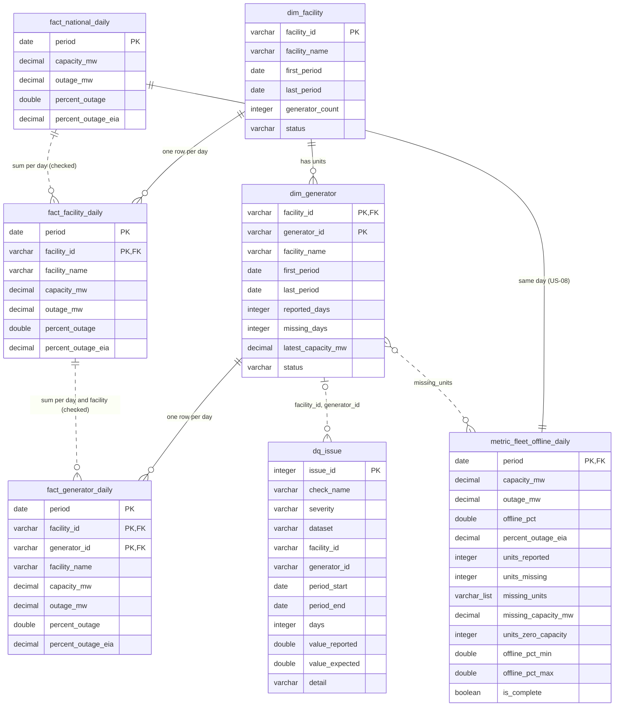

# Data model

Built by `uv run outage-model` from `data/raw` into `data/model/builds/<build_id>/`;
`data/model/current.json` names the live build. Column descriptions, types and keys are defined once
in [`backend/src/outage_explorer/model/tables.py`](../backend/src/outage_explorer/model/tables.py);
the entity boxes below are generated from it.

Solid lines are foreign keys enforced when the build creates the tables (a violation fails the
build). Dotted lines are relationships that EIA's data is expected to satisfy but does not have to.
Each one is checked on every build and any break is written to `dq_issue`:

- the national row = the sum of the facility rows = the sum of the generator rows, per day (`grain_mismatch_national`);
- a facility row = the sum of its generators (`grain_mismatch_facility`);
- a unit has a row on every day of its lifetime (`unit_reporting_gap`; missing units are listed in
  `metric_fleet_offline_daily.missing_units`).

Every `fact_*_daily` table also has the lineage columns `_run_id` (the extraction run that last changed
the row) and `_ingested_at`. The fact tables are stored as `year=YYYY/` partitions (DECISIONS.md #16).

## Keys and types

| Table | Primary key | Notes |
|---|---|---|
| `dim_facility` | `facility_id` | one row per facility |
| `dim_generator` | `facility_id, generator_id` | one row per facility and generator |
| `fact_national_daily` | `period` | one row per day |
| `fact_facility_daily` | `period, facility_id` | one row per day and facility |
| `fact_generator_daily` | `period, facility_id, generator_id` | one row per day, facility and generator |
| `metric_fleet_offline_daily` | `period` | one row per day |
| `dq_issue` | `issue_id` | one row per finding |

- Ids (`facility_id`, `generator_id`) are `VARCHAR`, as EIA sends them. A generator id is only unique
  within its facility (DECISIONS.md #1).
- MW are `DECIMAL(12,3)`: exact, so the grains reconcile to `0.000` (DECISIONS.md #14).
- `percent_outage` is recomputed (`DOUBLE`, NULL when capacity ≤ 0). `percent_outage_eia` is EIA's
  rounded value.

## At much larger volumes

Today the full history is 1.16M rows and ~2 MB of Parquet, and a full rebuild takes ~25 s. If the
data grew by orders of magnitude (hourly data, many more sources), we would change:

- **Incremental builds instead of full rebuilds.** Rebuild only the year partitions that the
  extraction touched (the run metadata already lists them), plus the small dimensions. Trade-off:
  checks that span partitions, like reporting gaps across a year boundary, have to read the
  neighbouring partition too.
- **Finer partitions** (year/month), once a year no longer fits comfortably in one file, keeping the
  date-first layout that matches the query patterns.
- **A table format (Delta/Iceberg) instead of folder swaps** for atomic commits, time travel and
  concurrent readers on object storage. Trade-off: one more dependency and its compaction to run.
- **Pre-aggregated rollups** (monthly, by plant) for the UI, so charts never scan daily unit rows.
